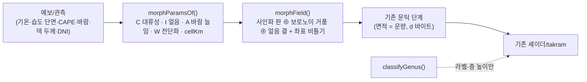

# 연속 형태 생성기(morph) 도입 계획

> 목표: "예보 → 구름 이름 → 프리셋" 대신 **"예보 → 연속 물리 손잡이 4개 → 하나의 형태 생성기"** 로 날씨 타일을 만든다.
> 원칙(프로젝트 관례 그대로): 옵션 `morph` **기본 끔**, 끄면 날씨 바이트·셰이더 글자 **그대로**(G3). 기존 `FIELDS`·`GENUS`·`classifyGenus` 는 지우지 않는다.

## 1. 구조



끼우는 자리는 **한 곳**: [`genusWeatherSteps`](file:///Users/yunhyeongseob/dev/solar-path/src/components/VolumetricProbe/cloudGenus.ts#L717) 의 `FIELDS[L.genus](...)` 호출. `L.opts.morph` 가 있으면 `morphField` 를 부르고, 그 뒤 문턱·운량 처리는 그대로 탄다(§139 skeleton 이 들어간 방식과 같음).

## 2. 손잡이 4개 (초안 — 숫자는 시작값, 자로 고정 전)

| 손잡이 | 뜻 | 입력 → 식(초안) |
|---|---|---|
| **C** 대류성 0~1 | 판(0) ↔ 거품(0.5) ↔ 탑(1) | `0.4·smooth(CAPE, 50, 1000) + 0.4·smooth(덱 두께, 0.3, 2 km) + 0.2·불안정(층 안 dθ/dz)` , 역전(dθ/dz ≥ 4 K/km)이 층 바로 위면 ×0.6 |
| **I** 얼음 0~1 | 둥근 덩어리 ↔ 실오라기 결 | 층 가운데 기온의 [`iceFraction`](file:///Users/yunhyeongseob/dev/solar-path/src/components/VolumetricProbe/cloudPhysics.ts#L96-L101) |
| **A** 바람 늘임 | 등방 ↔ 바람 방향 줄 | `1 + 2·smooth(|V_층|, 5, 20 m/s)` , 방향 = 층 바람 |
| **W** 전단파 진폭 | 물결 무늬 | 기존 `FLOW_WAVE_S0/S1` 발단식 재사용 (층간 바람 차 / 고도 차) |
| cellKm | 덩어리 크기 | `덱 두께 × lerp(4, 1.3, C)` (얇은 중층 ≈ 0.4 km, 두꺼운 저층 ≈ 2 km — 지금 `aspectSpacingKm` 와 같은 생각) |

## 3. 생성기 수식 (`morphField`, 기존 잡음 함수 재사용 — 새 라이브러리 없음)

```
u' = u + warp(u)                                  // 좌표 비틀기(fbm), 바둑판 제거
sheet  = spectralNoise(타일/(4·cellKm), A, 바람)   // 사인파 합: 부드러운 판·물결
bubble = 보로노이 돔(cells, cellKm) + C²·터렛     // 거품, C 가 클수록 부속 봉우리
fiber  = (1 − |2·fbm2(바람 방향 늘임) − 1|)^4      // 얼음 결
f = lerp(sheet, bubble, s(C))                      // s = smoothstep(0.15, 0.6)
f = lerp(f, fiber·sheet, I·0.8)
f = f · (1 − W + W·cos(2π k_w·u'))
```
세로 단면(셰이더 envelope)은 이번 단계에서 **모드 0(돔) 하나**로 두고 `base·top·edge` 만 C 로 연속 보간 → 셰이더 수정 없음. (렌즈↔돔 연속 보간은 셰이더를 건드려야 해서 2단계.)

밀도(`densityScale`)·운량 역표: 지금 종류별 표를 **C 에 따라 이웃 두 종류 값으로 선형 보간**(C 0 → st, 0.5 → sc, 1 → cu; I 높으면 ci/cs 쪽). 물리(§136)는 그대로 별도 옵션.

## 4. 바꿀 파일

| 파일 | 변경 |
|---|---|
| `src/components/VolumetricProbe/cloudMorph.ts` **(새 파일, 순수 함수)** | `MorphParams` 타입, `morphParamsOf(layer, thermo)`, `morphField(S, tileKm, seed, m)`, `morphShapeOf(m)`(base/top/edge/densityScale 보간), `morphCoverIn(m, cover)` |
| `cloudGenus.ts` | `GenusParams.morph?: MorphParams` 추가, `genusWeatherSteps` 에 분기 1개, `genusLayerShape` 에서 morph 있으면 `morphShapeOf` 사용. 잡음 헬퍼(`spectralNoise`·`cells`·`fbm`·`fbm2`) export |
| `volumetricScene.ts` | 옵션 `morph: boolean`(기본 false), `weatherPlan` 에서 morph 켜지면 `opts.morph` 채움(캐시 키 자동 포함), 운량 역표를 `morphCoverIn` 으로. `flow`/`skeleton` 과 동시 사용은 throw |
| `liveScene.ts` | 변경 없음 또는 최소(이미 `thermo`·층 바람·덱 두께를 넘김 — 확인 후 필요한 값만 추가) |
| `SkyScreen/DevTuningPanel.tsx` | MORPH 칩 하나 |
| `tools/genus-ruler/morph/morph-test.mjs` **(새)** | 단위 테스트: 결정론(같은 시드 같은 바이트), 손잡이 경계 연속성(C 0.49 vs 0.51 의 타일 차이가 작음), 면적 = 운량, 끄면 기존 바이트 동일 |

## 5. 단계

1. `cloudMorph.ts` + 단위 테스트 (렌더 없음)
2. 배선(옵션 기본 끔) → `tsc --noEmit`, 기존 테스트 통과, 끄면 바이트 동일 확인
3. 개발 패널에서 MORPH 켜고 기기/하네스로 눈 확인 — 같은 장면에서 C·I 를 슬라이드해 **튀지 않고 연속으로 변하는지**
4. (선택) 자(RULER-morph) 사전 등록 후 판정 → 통과하면 기본 켬

## 6. 알려진 위험

- 운량 역표: 위에서 본 면적과 아래에서 본 면적 차이(§127)는 보간 표로 대충 맞출 뿐 — 재측정 전까지 운량이 ±10~20 %p 어긋날 수 있음.
- 손잡이 식의 계수는 손값이다. "물리에서 바로" 는 입력 쪽이고, 계수는 결국 사진/눈으로 맞춰야 함.
- 적란운 모루(`cbanvil`)는 이번 범위 밖(기존 경로 유지).
